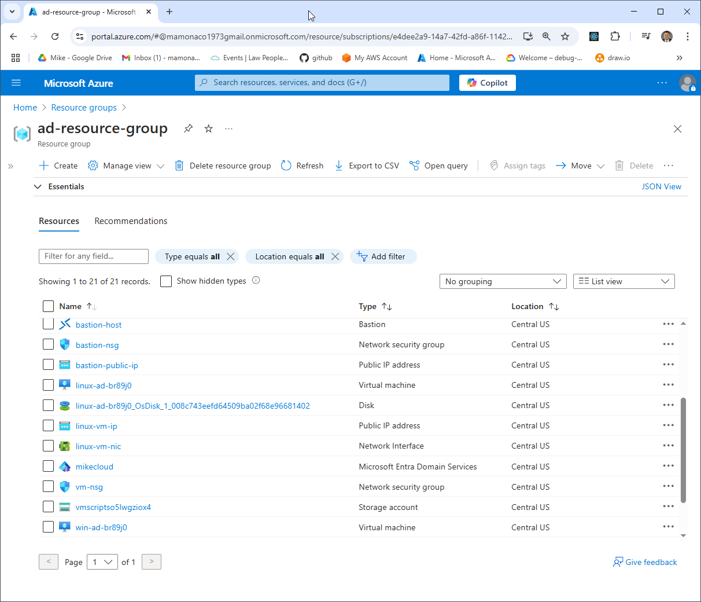
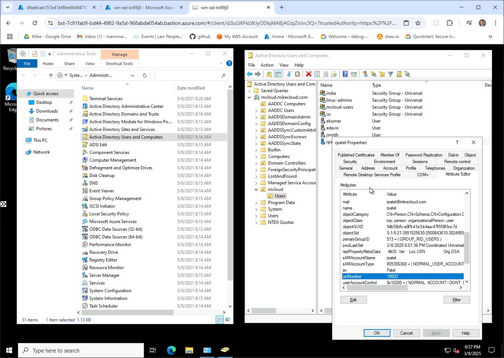

# Microsoft Entra Domain Services on Azure

Part 2 of the series
[Deploying Active Directory in the Cloud](https://youtu.be/H5lKJPJBL5s).
Terraform builds **Microsoft Entra Domain Services** (formerly Azure AD DS),
Azure's managed Active Directory domain, creates an Entra ID administrator
for it, then deploys a Linux and a Windows VM that join the domain at boot.
The Windows VM also creates the lab's users and groups, with the POSIX
attributes Linux needs.

| Piece | Where | Role |
|---|---|---|
| **Entra Domain Services** | `aadds-subnet` (10.0.0.128/25) | managed domain `mcloud.mikecloud.com` (`mikecloud`, Standard SKU); the VNet's DNS servers point at it |
| **Entra ID admin** | your tenant | `mcloud-admin-<hex>@<default domain>`, a member of `AAD DC Administrators`, synced into the managed domain |
| **linux-ad VM** | `vm-subnet` (10.0.0.0/25) | Ubuntu 24.04, `Standard_B1s`; joins with `realm` and SSSD; SSH with AD passwords |
| **win-ad VM** | `vm-subnet` | Windows Server 2022 Datacenter, `Standard_DS1_v2`; joins the domain; installs RSAT; creates the AD groups and users |
| **Key Vault** | `ad-resource-group` | `ad-key-vault-<suffix>`: AD admin, user and VM passwords; read by the VMs' managed identities |
| **Blob Storage** | `ad-resource-group` | serves the Windows join script to the Custom Script Extension |
| **NAT gateway** | both subnets | outbound internet for the VNet |

## Architecture

<picture>
  <source media="(prefers-color-scheme: dark)" srcset="architecture-dark.svg">
  
</picture>

Regenerate with `python3 make_diagram.py`.

- **`01-directory/`**: the resource group (`ad-resource-group`), the VNet
  (`ad-vnet`) with `vm-subnet` and `aadds-subnet`, the NAT gateway, the NSGs
  (`aadds-nsg` opens 443, 3389, 5986 and 636 as the managed domain
  requires), the Key Vault and user passwords, and the managed domain.
  Azure Bastion is optional (`bastion_support`, off by default).
- **`02-servers/`**: the Entra ID admin user and its group membership, the
  admin secret, the Linux and Windows VMs with their managed identities, and
  the Blob Storage account for the Windows join script.

## How the domain gets an admin

Entra Domain Services doesn't create an administrator. Members of the
`AAD DC Administrators` Entra ID group get admin rights in the managed
domain once their passwords have synced. `apply.sh` creates that group if
it's missing, and `02-servers` creates `mcloud-admin-<hex>`, adds it to the
group, and stores its credentials in Key Vault as `admin-ad-credentials`.

## How the members join

1. **Windows**: the Custom Script Extension downloads `ad-join.ps1` from Blob
   Storage. It installs RSAT and the Azure CLI, reads the admin secret with
   the VM's managed identity, and joins with `Add-Computer`. It then creates
   an `mcloud` OU with a `Users` OU, the groups, and, from each user's
   secret, the users, each with a `uidNumber` and `gidNumber`; adds
   `MCLOUD\mcloud-users` to Remote Desktop Users; and reboots.
2. **Linux**: reads the admin secret with its managed identity and joins
   with `realm join`. SSSD is set for short names and the POSIX IDs stored
   in AD; home directories are created on first login; `linux-admins` get
   passwordless sudo.

| User | Groups | uidNumber | sudo on Linux |
|---|---|---|---|
| jsmith | mcloud-users, us, linux-admins | 10001 | yes |
| edavis | mcloud-users, us | 10002 | no |
| rpatel | mcloud-users, india, linux-admins | 10003 | yes |
| akumar | mcloud-users, india | 10004 | no |

| Group | gidNumber |
|---|---|
| mcloud-users | 10001 |
| india | 10002 |
| us | 10003 |
| linux-admins | 10004 |

## Network security

```
internet ─22, 3389─▶ vm-subnet (linux-ad VM, win-ad VM)
```

`vm-nsg` allows 22 and 3389 from anywhere; every login still needs an AD
account. The managed domain has no public address.

## Prerequisites

* [An Azure Account](https://portal.azure.com/)
* [Install AZ CLI](https://learn.microsoft.com/en-us/cli/azure/install-azure-cli)
* [Install Terraform](https://developer.hashicorp.com/terraform/install)
* [Install jq](https://jqlang.github.io/jq/download/)

`check_env.sh` expects a service principal in `ARM_CLIENT_ID`,
`ARM_CLIENT_SECRET`, `ARM_SUBSCRIPTION_ID` and `ARM_TENANT_ID`. It also needs
Microsoft Graph permissions to create Entra ID users and groups. If this is
your first time watching our content, we recommend starting with this video:
[Azure + Terraform: Easy Setup](https://www.youtube.com/watch?v=wwi3kVgYNOk).

## Deploy

```bash
git clone https://github.com/mamonaco1973/azure-directory.git
cd azure-directory
./apply.sh       # 1: VNet + Entra Domain Services + Key Vault  2: admin user, Linux and Windows VMs
```

Everything deploys to Central US. Phase 1 takes **60–90 minutes**, almost
all of it Azure creating the managed domain. `apply.sh` looks up your
tenant's default domain for the admin's UPN. `apply.sh` ends by running
`validate.sh`, which prints the resource group, Key Vault and the two hosts:

```
NOTE: Resource Group:        ad-resource-group
NOTE: Key Vault:             ad-key-vault-a1b2c3d4
NOTE: Windows RDP Host:      win-ad-a1b2c3.centralus.cloudapp.azure.com
NOTE: Linux SSH Host:        linux-ad-a1b2c3.centralus.cloudapp.azure.com
```

## Try it

1. Get a user's password:

   ```bash
   vault=$(az keyvault list -g ad-resource-group --query "[?starts_with(name, 'ad-key-vault')].name | [0]" -o tsv)
   az keyvault secret show --vault-name "$vault" --name jsmith-ad-credentials \
     --query value -o tsv | jq -r .password
   ```

2. The managed domain and everything else is in `ad-resource-group`:

   

3. RDP to the **Windows RDP Host** as `MCLOUD\jsmith`. **Active Directory
   Users and Computers** shows the OUs, users and groups the VM created.

   

4. SSH to the **Linux SSH Host** as `jsmith`. Try `id`,
   `getent group linux-admins` and `sudo -l`.

   

## Troubleshooting

| Symptom | Fix |
|---|---|
| Phase 1 seems stuck | Creating the managed domain takes 60–90 minutes. |
| The joins fail with bad credentials | The admin's password hasn't synced into the managed domain yet; this can take up to 30 minutes after the user is created. |
| `id jsmith` finds nothing on Linux | The Windows VM hasn't created the users yet. SSSD caches lookups; `sudo sss_cache -E` clears it. |
| RDP rejects `MCLOUD\jsmith` | Read `C:\WindowsAzure\Logs\ad-join.log` on the Windows VM. |

## Teardown

```bash
./destroy.sh     # destroys the VMs and admin user, then the managed domain, VNet and Key Vault
```

## Notes

- **Lab only.** SSH and RDP are open to the internet, and both joins use the
  domain administrator. Restrict `vm-nsg` and use a dedicated join account
  for anything more.
